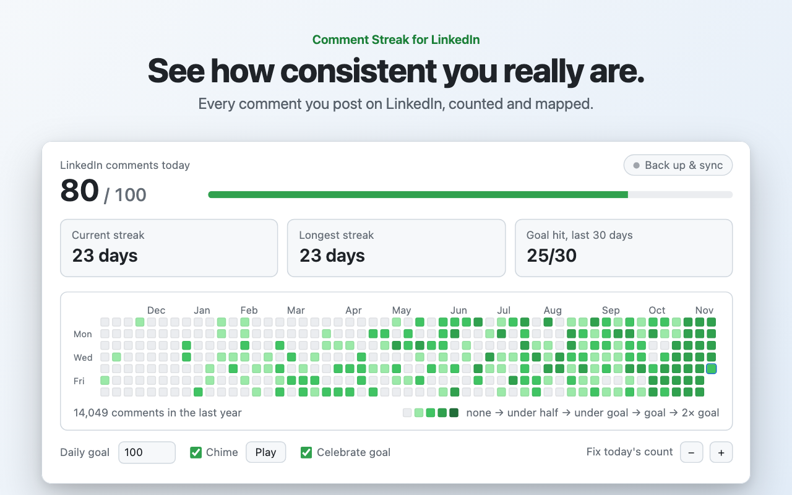
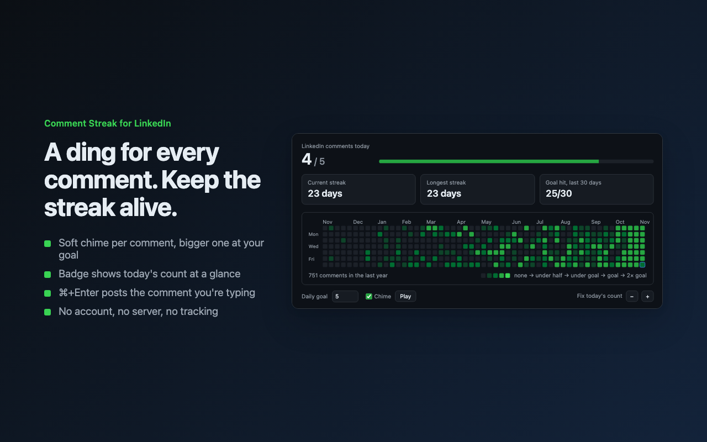

# Comment Streak for LinkedIn

[](https://github.com/authenticryan/linkedin-comment-streak/actions/workflows/ci.yml)

**A GitHub-style streak for your LinkedIn comments.**

Comment Streak is a Chrome extension. It counts the comments that you post on LinkedIn and shows them on a heatmap for one year. You set a daily goal. The default goal is 100 comments, because the extension is for power users. For each comment, the extension plays a short sound and adds 1 to the toolbar badge. When you reach your goal, the badge changes to green.



**Chrome Web Store:** [install](https://chromewebstore.google.com/detail/comment-streak-for-linked/gmflljeahipnkaahfcplloegahoefkbg) · **Download:** [latest release](https://github.com/authenticryan/linkedin-comment-streak/releases/latest) · **Privacy:** [no data goes out of your browser unless you turn on sync](PRIVACY.md)

---

## Why I made this extension

Many guides about LinkedIn give the same advice: write good comments on the posts of other people every day. Comments start conversations with new people. They also show your name to people who do not follow you, before your own posts become popular.

I set a goal of 100 comments each day. Then I found that I could not see if I reached this goal. LinkedIn shows the views on your posts. It does not show how many comments you write each day. The habit is effective only if you do it every day, and I could not see that part.

Software developers have a solution for this problem: the GitHub contribution graph. The graph shows a green square for each day that you did work. The green squares give you a reason to continue each day.

I made the same type of graph for LinkedIn comments. At 100 comments each day, you cannot count by hand. For this reason, the extension counts automatically. It stays in the toolbar, where you can see it all day.

## What the extension does

- **Automatic count.** When you post a comment or a reply on linkedin.com, the extension counts it. You do not record it yourself. The extension does not count edits, deleted comments, or posts that fail.
- **Toolbar badge.** The badge shows the number of comments for today. The badge changes from blue to green when you reach your goal.
- **Daily goal.** The default goal is 100 comments each day. You can set a goal from 1 to 1,000 in the popup.
- **Heatmap and streaks.** The heatmap shows each day of the last year. The color of a day shows how near you were to your goal:
  - Light green: less than half of your goal
  - Medium green: less than your goal
  - Dark green: your goal
  - Darkest green: two times your goal, or more

  The extension also shows your current streak and your longest streak. It also shows the number of days in the last 30 days that you reached your goal. Put the pointer on a day to see its count.
- **A sound for each comment.** The extension plays a short two-note sound for each comment. When you reach your goal, it plays a brighter four-note sound. To hear the sound, click **Play**. To hear the goal sound, hold Shift and click **Play**. On a LinkedIn tab, this also shows the goal celebration. You can also set the sound to off.
- **A celebration at the goal.** When you post the comment that completes your goal, the LinkedIn page goes dark. A card counts up to your goal. Then confetti in the heatmap colors bursts, and the square for today changes to green. The card shows your streak, your number of goal days, and the time that you completed the goal. The card stays until you close it. To see the full goal moment, open LinkedIn, hold Shift, and click **Play** in the popup. You can also set the celebration to off.
- **⌘+Enter to post.** Press ⌘+Enter (Ctrl+Enter on Windows) to post the comment in the comment box.
- **Manual correction.** If the count for today is not correct, use **−** and **+** to correct it.
- **Backup and sync (optional).** Click **Back up & sync** in the popup and type your email. The extension sends a 6-digit code to your email. Type the code in the popup. Your counts and your goal then sync between your computers. If you use a new computer, sign in, and your heatmap comes back. While you comment, the extension sends your counts a maximum of one time each hour. To send them immediately, click **Sync now**. The panel shows the number of comments that the server saved, and it shows if this number is the same as the popup. The extension works the same without an account.
- **Privacy.** The extension has no analytics. It does not read the text of your comments. Without sync, no data goes out of your browser. With sync, the server stores only your email, your counts for each day, and your goal.



## Product decisions

In a small product, the most important decisions are about what to remove. This table gives each decision and the reason for it.

| Decision | Reason |
|---|---|
| **Set the default goal to 100** | This extension is for power users who write many comments each day. A low default goal, such as 5, gives no challenge to these users. If your target is different, you can set a goal from 1 to 1,000. |
| **Count automatically from the LinkedIn request** | People do not continue to use a tracker if they must record each item. The extension monitors the "comment saved" request from LinkedIn. You do no work, and the extension counts only the comments that LinkedIn saved. |
| **Count one action only, and ignore similar requests** | Approximately 80 ms before each `createComment` request, LinkedIn sends a similar `submitCommentButton` request. If the extension counted the two requests, each number would be two times too large. People do not continue to use a tracker that shows incorrect numbers. |
| **Use the goal to set the color, not the quantity** | GitHub sets the color of a day from the quantity of work. In this extension, the color answers one question: did you reach your goal? Dark green shows that you reached it, for a goal of 20 or a goal of 100. |
| **Keep the streak until the day ends** | If the streak changed to 0 each morning before your first comment, you would see this as a penalty. As on GitHub, the streak from yesterday continues until midnight. |
| **Show "Goal hit, last 30 days" next to the streak** | If you miss one day, the streak changes to zero. At that time, many people stop. A value such as 25/30 shows that you are still consistent, so one bad day does not stop the habit. |
| **Play a sound, and a brighter sound at the goal** | Immediate feedback helps people to continue a habit. The goal sound shows that you completed the goal for the day. The browser makes the sound, so the extension has no audio files. You can set the sound to off. |
| **Celebrate the goal with a full-page moment** | 100 comments in one day is a lot of work. A badge that changes color does not show this. The card stops you for a few seconds, so you can feel the result. The confetti uses the heatmap squares, and the square for today changes to green, so the moment connects to your streak. The card shows one time each day, and it stays until you close it. It does not interrupt each comment. |
| **Let users correct the count** | The count uses the LinkedIn website, and LinkedIn changes its website. With **−** and **+**, you can correct a missed comment in two seconds, and you keep your streak. |
| **⌘+Enter clicks the LinkedIn button** | The shortcut makes the main action faster, but it does not make the action automatic. You write and send each comment yourself. For this reason, the extension does not go against the LinkedIn rules about automation. |
| **Use the name "Comment Streak for LinkedIn"** | If a name starts with "LinkedIn", it looks like an official LinkedIn product. The Chrome Web Store can reject an extension for this reason. A name such as "X for LinkedIn" is safe for review, and people can find it when they search. The listing does not use the LinkedIn logo. |
| **Few permissions** | LinkedIn contains much private data. For this reason, the extension reads only the address and the status of LinkedIn requests, and only on linkedin.com. Users can trust the extension, and the store review is easier. Sync did not add a permission: the server allows requests from the extension (CORS). The `scripting` permission lets the extension show the celebration on a LinkedIn tab that was open before an update. Chrome does not show a warning for it. |
| **Make the account optional** | The first promise of the extension was "no data goes out of your browser". Sync must not break this promise for users who do not want it. Thus, the extension works fully without an account, and sync is an extra. |
| **Sign in with an emailed code, not a password or a magic link** | A password is one more thing to remember for a free tool. A magic link opens in the browser where you read your email, and this is often a phone. The phone cannot give the sign-in to the extension on your computer. A 6-digit code operates on all devices. The code also shows in the subject of the email, so you can read it in a phone notification. |
| **Count for each computer, and add on the server** | If two computers send "today: 40" and "today: 25", one number must not replace the other. Each computer writes only its own rows, and the server adds the rows. Thus, no change from one computer can remove a change from another computer. |
| **Ask for product-update consent at sign-up** | A later CRM (Twenty) can send emails only to users who agreed. It is not possible to get this consent from earlier users after the sign-up. Thus, the sign-up form has a check box for updates. The check box is empty by default. |
| **Desktop only, and the documentation says this** | A Chrome extension cannot monitor the LinkedIn mobile app. This README and the store listing tell you this, so a low count is not a surprise. |

## Technical design

- **Manifest V3, JavaScript only, no build step, no dependencies.** The extension has approximately 1,400 lines. The store package is approximately 24 KB.
- **The extension counts comments, but does not read them.** The background service worker monitors `webRequest.onCompleted` for two LinkedIn URL patterns. It reads only the method, the URL, and the status code of each request. When a `POST` to the LinkedIn create-comment action gives a 2xx status, the extension counts one comment. It does not read the body of a request or a response.
- **Two versions of the LinkedIn website.** The classic LinkedIn web app uses the Voyager REST API. The new web app sends all actions to one endpoint, and an `sduiid` parameter gives the name of the action. The matcher function examines the two versions and has a GraphQL fallback. Version 1.1.0 added support for the new app. Before version 1.1.0, the extension did not count comments in the new app.
- **No lost counts.** All storage writes go through a queue, so two comments that you post at almost the same time cannot overwrite each other. A 2-second guard makes sure that the extension counts each comment only one time.
- **Sound from a service worker.** In Manifest V3, a service worker cannot play audio. For this reason, the sound plays in an offscreen document. The Web Audio API makes the sound from sine tones and one overtone, so the extension has no sound files.
- **Tests with real data.** The tests use request names from linkedin.com. These names include the similar requests that the extension must not count. The tests also examine the streak and color rules. The tests use the built-in test runner of Node.
- **Fast repairs.** The service worker records each LinkedIn `POST` request in the console. If LinkedIn changes its endpoint, the new request name shows in the console after one test comment. [MAINTAINING.md](MAINTAINING.md) gives the repair procedure.
- **Store images from the real interface.** A script opens the real popup and the real goal celebration in headless Chrome with sample data for one year. Thus, the screenshots show the real product, not a mockup. The Chrome Web Store shows each screenshot at approximately half size. For this reason, the product fills most of each screenshot, and the text is large.
- **Sync server with one dependency.** The optional sync server is in `server/`. It runs on Vercel Functions, stores data in Neon Postgres, and sends sign-in codes with Resend. It uses no framework and no authentication library. Its only runtime dependency is the Neon database driver. The server keeps codes and session tokens only as hashes. Each code operates one time, for 10 minutes, for a maximum of 5 attempts. The server sends a maximum of 5 codes for each email in one hour.
- **Server tests with real Postgres.** The server tests run all of the SQL against PGlite. PGlite is Postgres compiled to WebAssembly, so the tests need no database server. The tests examine sign-in, rate limits, the sync between two computers, the goal, consent, and the deletion of an account.
- **Sync that repairs itself.** Each sync sends all of the counts of the computer (a few KB), not only the changes. If one sync fails, the next sync makes the server correct again. While you comment, a sync occurs a maximum of one time each hour. The count on your computer changes immediately. Only the copy on the server waits. This decreases the server requests by approximately 15 times, so that the free plans can support more users.
- **Light and dark themes.** The extension uses the theme of your system and the colors of the GitHub contribution graph.
- **Release pipeline.** For each push, GitHub Actions examines the manifest and runs the tests. When you push a `v*` tag, GitHub Actions makes the store zip file and publishes a GitHub release. The release notes come from the changelog. If the tag and the manifest version are different, the release stops.

## Go-to-market notes

This section shows how I would change this side project into a product that people can find.

- **Users:** Power users who write many comments each day to grow on LinkedIn. Examples:
  - Creators who use comments as their main growth channel
  - Founders and B2B sellers who use social selling at high volume
  - Job seekers who write many comments to show their name to hiring managers
- **Positioning:** For power users who make a LinkedIn presence with comments, Comment Streak shows daily consistency. LinkedIn analytics tools monitor results that you cannot control, such as views and followers. Comment Streak monitors the input that you can control: your comments. AI comment tools write comments for you. Comment Streak does not.
- **Discovery:** The first channel is search in the Chrome Web Store, for example "LinkedIn comments", "LinkedIn streak", and "LinkedIn habit". For this reason, the name, summary, and screenshots of the listing do most of the work. The second channel is LinkedIn. Growth coaches tell their clients to write comments each day. This extension gives the coaches a tool to recommend.
- **The product is its own marketing:** For software developers, a green contribution graph shows status. A future feature can make an image of your heatmap, for example "9,000 comments in 90 days". When users post this image on LinkedIn, it goes to the people who are most likely to install the extension.
- **Metrics:** The extension has no analytics, and this is intentional. For this reason, the Chrome Web Store dashboard gives the metrics: weekly active users, installs compared with uninstalls, and rating. Sync gives two more metrics: the number of accounts, and the number of users who agreed to get product updates.
  - Activation: the extension counts the first comment of a user. This shows that the count operates for that user.
  - Retention: the user is still active after 30 days.

  For more detailed metrics, opt-in telemetry is necessary. Telemetry would decrease the trust of users.
- **CRM:** The users table is in my own Postgres database. When the extension has more than 1,000 accounts, I will connect it to Twenty, an open-source CRM that I can host myself. The CRM will manage the relationship with users who agreed to get updates. The extension stays free.
- **Largest risk:** The extension depends on the LinkedIn platform. LinkedIn can change its website at any time. This occurred one time before (version 1.1.0). These items decrease the risk:
  - Tests that use real request names
  - A debug log and a repair procedure
  - Manual correction of the count
  - A planned self-check that shows when the count stops

## Roadmap

- **Export.** Save your history as a file, for users who do not want an account.
- **Self-check.** If you click **Comment** and the extension does not count a comment, the badge shows "!". Thus, you see a LinkedIn change in seconds, not in days.
- **Weekly summary.** Compare this week with last week.
- **Heatmap image.** Make an image of your heatmap that you can share (the growth loop above).
- **Microsoft Edge Add-ons.** I expect that the same package operates in Edge without changes.

## Install from the source code

1. Clone this repository.
2. In Chrome, open `chrome://extensions`.
3. Set **Developer mode** to on.
4. Click **Load unpacked**.
5. Select the `extension/` folder.
6. Click the puzzle-piece icon in the toolbar.
7. Pin **Comment Streak for LinkedIn**.
8. Post a comment on linkedin.com.
9. Make sure that the count on the badge increases by 1.

After you pull an update:

1. In `chrome://extensions`, click ↻ on the extension.
2. Refresh your LinkedIn tabs.

```sh
npm test                    # Run the tests for the count, streaks, and heatmap
npm run check               # Examine the manifest and the syntax
npm run package             # Make dist/linkedin-comment-streak-<version>.zip for the Chrome Web Store
sh scripts/store-assets.sh  # Make the store images and icons again (macOS, Chrome is necessary)
```

It is not necessary to run `npm install`, because the extension has no dependencies. Node 20 or later is necessary.

## Repository

```
extension/              The extension. Load this folder unpacked.
  manifest.json         MV3 manifest: permissions, linkedin.com host, popup
  background.js         Service worker: finds comments, counts, badge, sound
  lib.js                Shared logic: comment matcher, streaks, heatmap colors
  sync.js               Optional sign-in and sync (runs in the background worker)
  config.js             Address of the sync server
  content.js            ⌘+Enter shortcut for the LinkedIn comment box
  celebrate.js          Goal celebration on linkedin.com (overlay, confetti)
  popup.html/css/js     Heatmap, streaks, and settings
  offscreen.*, chime.js Sound (Web Audio, no sound files)
  icons/
server/                 Optional sync server (Vercel Functions, Neon, Resend)
  api/                  One file for each endpoint
  lib/app.js            Sign-in, sync, and account logic
  schema.sql            Database tables
  test/                 API tests against real Postgres (PGlite)
tests/                  Logic tests (Node, no dependencies)
scripts/                Manifest check, store zip, release notes, store images, icons
store/                  Store screenshots, promo tile, icon, and their HTML sources
.github/workflows/      CI and releases from tags
MAINTAINING.md          Failures, repairs, and the release procedure
PUBLISHING.md           Chrome Web Store submission procedure
PRIVACY.md              Privacy policy
CHANGELOG.md            Release history
```

## Versions

The extension uses [Semantic Versioning](https://semver.org/). The version number in `extension/manifest.json` is the primary version number. All other version numbers must agree with it. Each release has a tagged commit, a [changelog](CHANGELOG.md) entry, and a GitHub release with the store zip file. [MAINTAINING.md](MAINTAINING.md) gives the full procedure.

## Credits

- Heatmap: the GitHub contribution graph and its colors.
- Ryan Dsouza made this extension, with [Claude Code](https://claude.com/claude-code) as the pair programmer.
- [MIT license](LICENSE). LinkedIn did not make this extension and has no connection with it.
