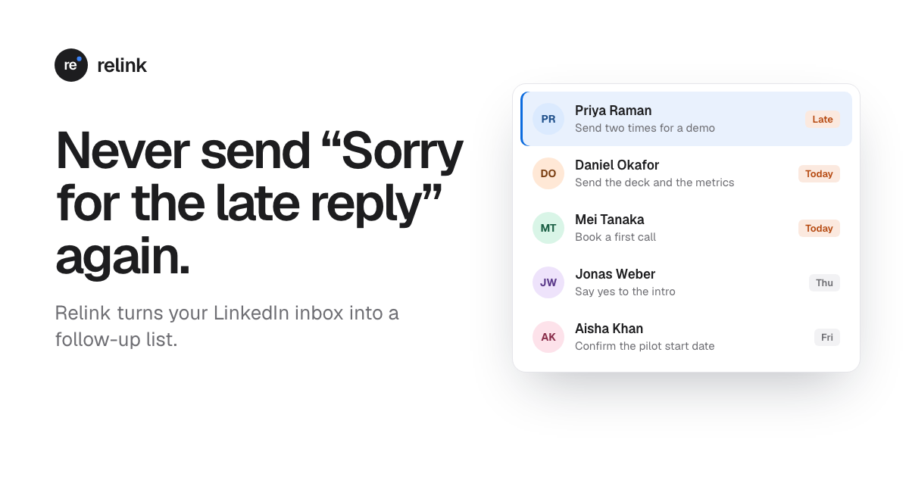

# Relink landing page

The landing page and waitlist for **Relink**, a follow-up inbox for LinkedIn. The page is live at **[tryrelink.live](https://tryrelink.live)**.

[](https://tryrelink.live)

Relink is my paid product. [Comment Streak](../README.md), in the root of this repository, is free. Comment Streak helps you start more conversations on LinkedIn. Relink makes sure that you reply to them on time. The Relink app is in a private repository. This folder contains only its landing page.

## The page

- **Hero.** One headline, one sentence, and one email field. Under the field, a live counter shows the real number of people on the waitlist.
- **An inbox that you can use.** The product demo is not a picture. Click the inbox, then use the keyboard. J and K move, E marks a conversation as done, H sets a reminder, and Z undoes.
- **The problem.** A LinkedIn thread shows a message from three weeks ago. Under it is a draft that starts with "Sorry for the late reply".
- **How it works.** Three steps: know who waits for you, reply on the day that you promised, and remember why each person is important.
- **Trust.** "It reads. You send." Relink never sends a message for you.
- **Founder note, pricing, and FAQ.** The note has fewer than 80 words. The early price goes only to people on the waitlist.

## Decisions

| Decision | Reason |
|---|---|
| **Write for founders** | Founders get customers, investors, and hires from the LinkedIn inbox. For them, a late reply can cost a deal. One audience makes each sentence specific. |
| **Start with the problem moment** | The copy uses Jobs to be Done. The headline names the moment that the product removes: the "Sorry for the late reply" message. Visitors know this moment, so they understand the product before they read about its features. |
| **Waitlist only, with the price after sign-up** | The product is not ready. The waitlist measures demand before the launch. The early price goes only to people on the list, so the sign-up has a clear reward. |
| **Show the real count** | Fake social proof destroys trust when people find it. The counter shows the real number from the database. At 0, it shows "Be the first on the waitlist". It says "people", not "founders", because the sign-ups are not verified. |
| **Let visitors use the product** | A picture shows a feature. A demo that you control with the keyboard shows how fast the product is. It also gives visitors a reason to stay on the page. |
| **Do not mention Comment Streak** | One page has one message and one action. The free extension has its own page in the Chrome Web Store. |
| **A logo that does not look like LinkedIn** | A LinkedIn look-alike can cause trademark problems and a Chrome Web Store rejection. The mark is a lowercase "re" on a dark circle. A blue dot shows the next reply that is due. The footer says that LinkedIn has no connection with Relink. |
| **Short copy and one font** | Most visitors scan a page. Each section has one headline and one line, so a scan gives the full message. The page uses one sans-serif font, Geist. |

## Technical design

- **No build step and no framework.** The page is static HTML, CSS, and JavaScript, approximately 2,100 lines. It has light and dark themes, phone layouts, keyboard focus, and a reduced-motion mode.
- **One serverless function for the waitlist.** `api/waitlist.js` runs on Vercel Functions in Singapore (sin1). It writes to a `waitlist` table in the Neon Postgres database of the [sync server](../server/). Its only runtime dependency is the Neon database driver.
- **Spam protection without a CAPTCHA.** A hidden field catches bots: the API returns success, but it saves nothing. The API accepts only JSON, so a form on a different site cannot send to it. Each request body has a limit of 4 KB.
- **A live count with few database queries.** The page asks for the count every 15 seconds, and it stops when the tab is hidden. The CDN keeps each answer for 5 seconds, so many visitors cause few queries. On the screen, the count never goes down.
- **Your place in line.** After sign-up, the page shows your place on the list and adds you to the counter. If an email signs up again, it keeps its first place, and the database gets no second row.
- **Attribution.** Each sign-up stores the UTM source, medium, and campaign. It also stores the host name of the site that sent the visitor, and the form that the visitor used.
- **Tests with real Postgres.** Nine API tests run against PGlite, which is Postgres compiled to WebAssembly. The tests examine sign-up, place in line, duplicate emails, the bot field, attribution, the cached count, and incorrect requests.
- **Images from HTML.** The logo (`brand/mark.html`) and the share image (`og/og.html`) are HTML files. Scripts make the PNG files with headless Chrome. Thus, a change to the logo is a change to one file. At 32 px and smaller, the letters and the dot are larger, so the icon stays clear at 16 px.

## Run and deploy

```sh
npm install
npm test              # Waitlist API tests (PGlite, no database server)
npm run dev           # Local preview on http://127.0.0.1:8790, with a waitlist in memory
npm run dev:neon      # Local preview with the real database (.env.local is necessary)
npm run migrate       # Make the waitlist table. It is safe to run this again.
sh brand/render.sh    # Make the logo, favicon, and extension icon PNG files (macOS, Chrome)
sh og/render.sh       # Make public/og.png
vercel deploy --prod  # Deploy to tryrelink.live
```

`.env.local` contains `DATABASE_URL`. Git and Vercel ignore this file. In Vercel, `DATABASE_URL` is an environment variable for production. Node 22 is necessary.

The domain is registered at GoDaddy. Its DNS has an `A` record for `@` and a `CNAME` record for `www`, and the two records go to Vercel. Vercel sends `www` and `http` requests to `https://tryrelink.live`.

## Files

```
public/              The page
  index.html         All sections of the page
  styles.css         Light and dark themes, phone layouts
  app.js             Inbox demo, live counter, waitlist forms
  og.png             Share image for link previews
api/waitlist.js      Vercel Function: GET the count, POST a sign-up
lib/waitlist.js      Request checks, email validation, SQL
lib/db.js            Neon database driver
lib/memory-db.js     PGlite, for tests and the local preview
schema.sql           The waitlist table
scripts/migrate.js   Applies schema.sql
dev.js               Local preview server
brand/               The Relink logo (mark.html) and its render script
og/                  The share image (og.html) and its render script
test/                Waitlist API tests
```
